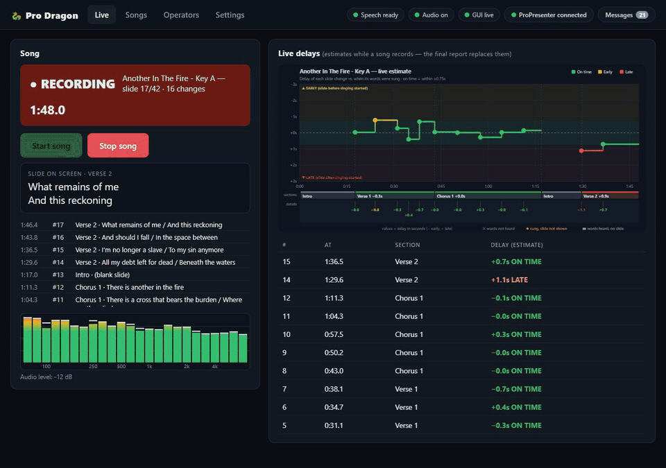
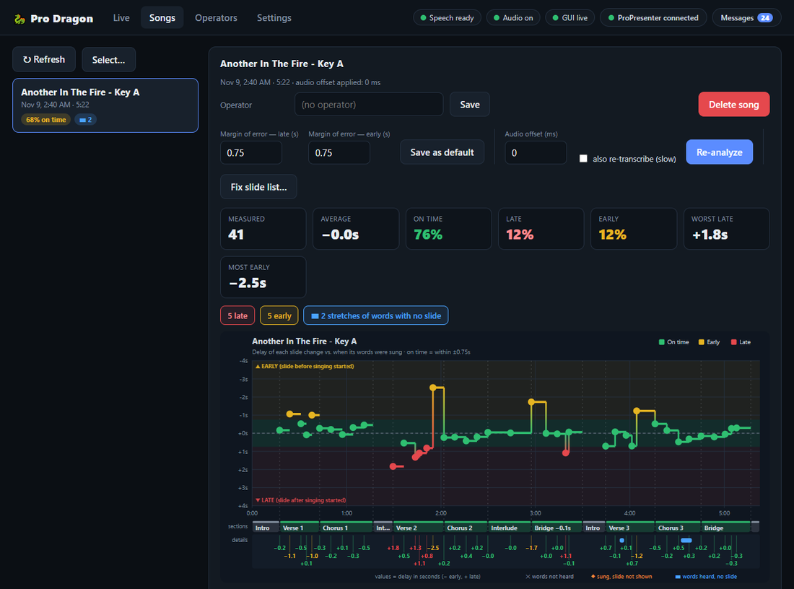

# Pro Dragon

Audits ProPresenter 7 operators during live worship songs. For **every slide change** it
reports how many seconds before or after the vocalist started singing that slide the
operator changed it:

```
delay = slide_change_time - vocal_onset_time
+ = LATE (singing started before the slide appeared)     - = EARLY (ideal)
```

The report lists each transition with its delay and the words on the slide, so it's easy to
see where an operator was slow. Pro Dragon only observes: it never controls ProPresenter.

## Screenshots

**Live** — while a song records: the slide on screen, each change as it happens, a live equalizer
and provisional delays (the final report replaces them at Stop).



**Songs** — each saved song gets a graph (green on time, yellow early, red late), a summary and a
per-slide table with the words on every slide.



## How it works

1. The operator presses **Start song / Stop song** for each song (GUI button or terminal key `S`).
2. **Slide changes** are read by polling ProPresenter's REST API (`/v1/presentation/slide_index`,
   about every 100 ms), each stamped to within half a poll interval.
3. **Audio** comes from speakers (Windows loopback), a mic / line-in / Dante virtual device, an
   NDI source, or a wav file, and is resampled to mono 16 kHz.
4. **Analysis** runs after Stop: [faster-whisper](https://github.com/SYSTRAN/faster-whisper)
   transcribes the song with word timestamps, then each slide is matched to where **its own
   words** were sung (not by slide position, so a band that skips or repeats sections is fine).
   Slides whose words weren't heard, lyrics sung but never shown, and words with no slide are
   reported separately.
5. **Live estimates** appear while the song plays (about 7 s after each change) and are replaced
   by the final analysis at Stop.
6. **Output** per song: `.wav`, `.json` (re-analyzable), `.txt` report, `.svg` step graph, plus a
   per-operator report and trend graph.

## Install

Python 3.10+ (tested on 3.11, Windows; macOS is the intended production platform).

```
install.bat          # Windows   (or ./install.sh on macOS)
```

Manual: `py -3.11 -m venv venv` then `venv\Scripts\pip install -r requirements.txt`.
Optional NDI audio: `venv\Scripts\pip install -r requirements-ndi.txt`.

In ProPresenter 7: Preferences → Network → **Enable Network**, and note the port (default 1025).
The first run downloads the Whisper `small` model (~250 MB).

## Run

```
venv\Scripts\python main.py --gui      # browser GUI at http://localhost:8765 (recommended)
venv\Scripts\python main.py            # terminal mode: S = start/stop song, Q = quit
venv\Scripts\python main.py --list-devices
venv\Scripts\python main.py --analyze reports\<session>\<song>.json [--offset-ms N] [--retranscribe]
venv\Scripts\python main.py --operators
```

The GUI connects to ProPresenter and your last audio source by itself, shows live delays and an
equalizer, and has tabs for saved songs (graphs, margins of error, re-analysis, deletion),
operators, and settings. See [QUICKSTART.md](QUICKSTART.md) for a walkthrough and
[CONFIG.md](CONFIG.md) for every setting.

## Accuracy

Whisper word timestamps on sung music are approximate (roughly ±0.3–0.5 s), which is fine for
seconds-scale slowness but not 100 ms precision. If captured audio arrives late versus the room
(NDI, network mixers) set `timing.offset_ms` so delays are corrected. Everything has been tested
with fakes plus real runs against ProPresenter 21.4.2; NDI has only been verified against a local
test sender.

## Security

The GUI has no login. It binds to `127.0.0.1` by default, requires a custom header on every POST
and checks WebSocket origins. If you set `gui.host` to `0.0.0.0`, anyone on the LAN can control it.

## Tests

```
venv\Scripts\python -m pytest tests
```

Tests use fakes and never touch real audio devices or ports.

## Project layout

See [CLAUDE.md](CLAUDE.md) for the architecture, module map and the reasoning behind key decisions.

## License

Apache License 2.0, see [LICENSE](LICENSE).
